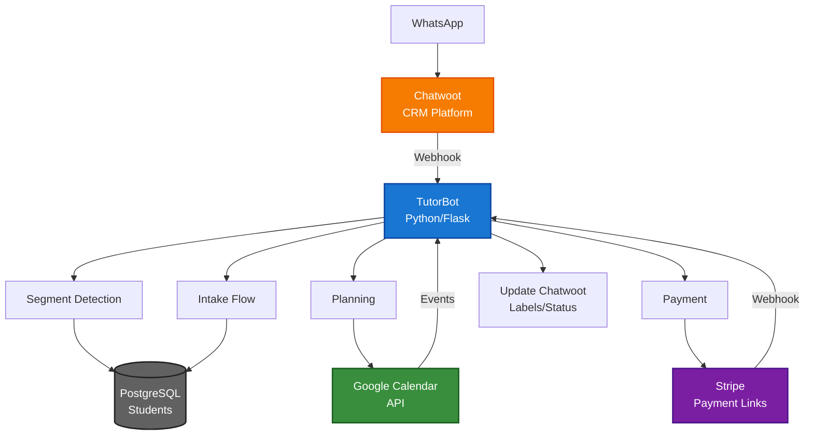
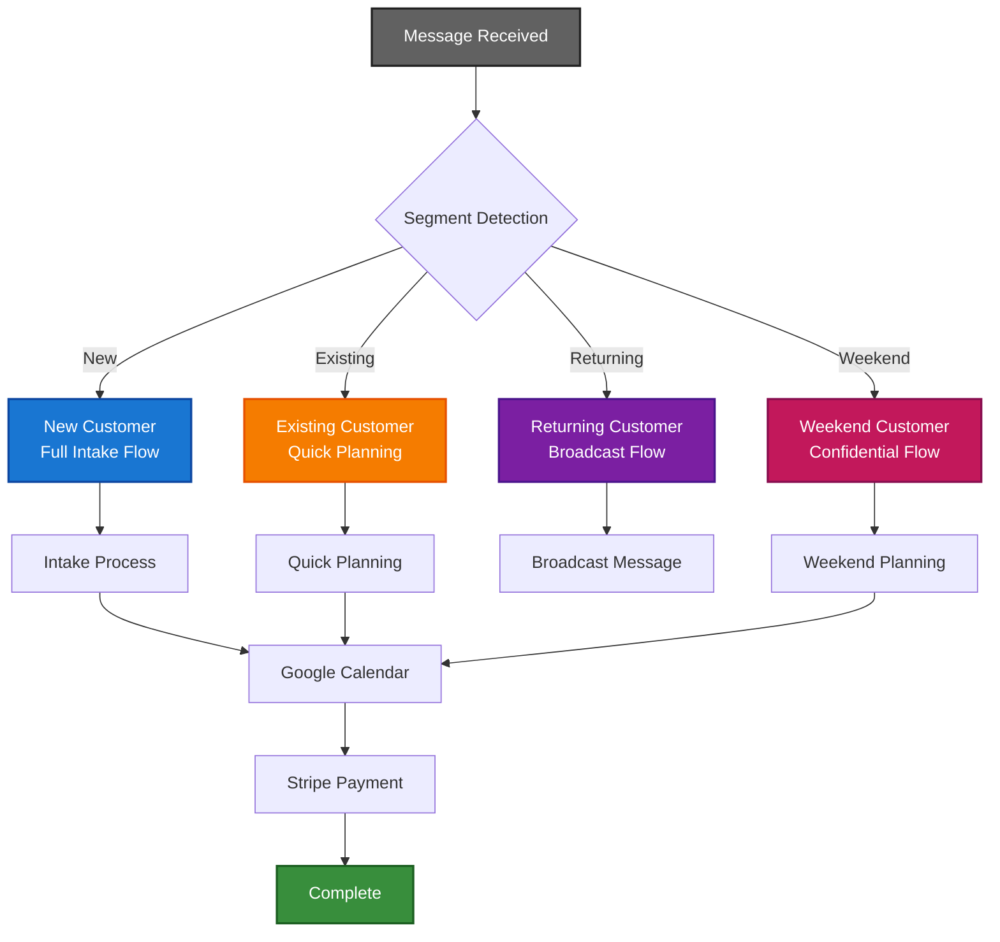
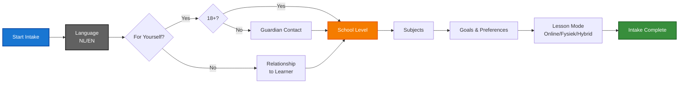
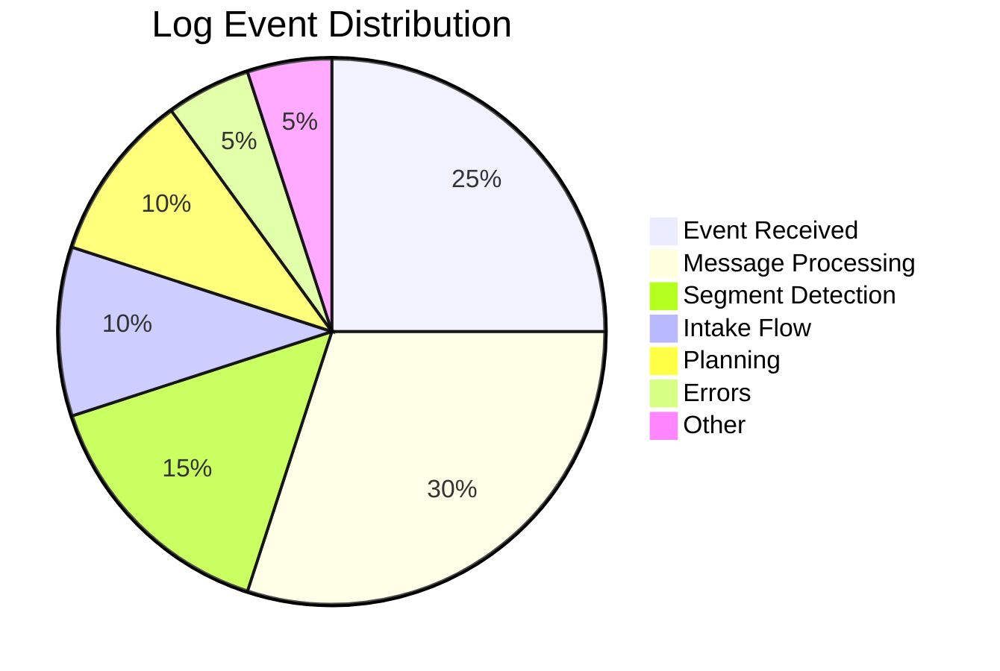
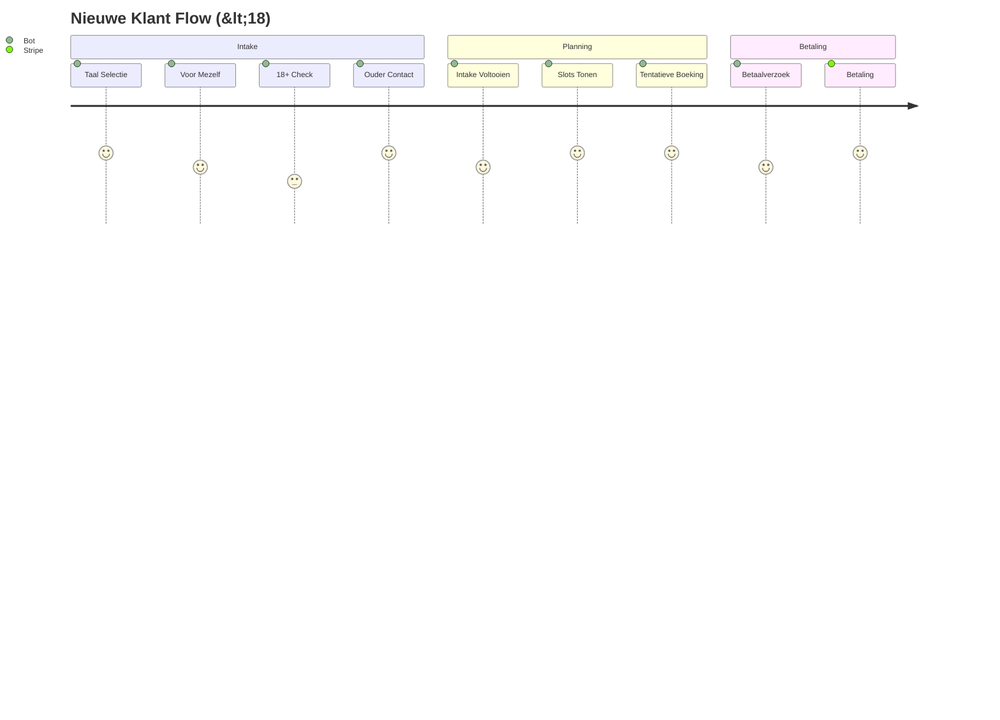

# TutorBot - WhatsApp Bot voor Bijlessen

Een geavanceerde WhatsApp-bot voor Stephen's bijles diensten, geïntegreerd met Chatwoot, Google Calendar en Stripe betalingen.

## Architecture



## 🎯 Functies

### Segment-detectie & Persoonlijke Benadering



- **Nieuwe klanten**: Volledige intake flow
- **Bestaande klanten**: Snelle planning op basis van voorkeuren
- **Terugkerende klanten**: Begin schooljaar broadcast flow
- **Weekend-klanten**: Vertrouwelijke stroom met speciale tarieven

### Interactieve Intake



- Taal selectie (NL/EN)
- Voor jezelf / voor iemand anders
- 18+ verificatie
- Opleidingsniveau & vakken
- Voorkeuren & doelen
- Lesmodus (online/fysiek/hybride)

### Slimme Planning
- Google Calendar integratie
- Segment-specifieke planning profielen
- Automatische slot suggesties
- Tentatieve boekingen

### Betaalintegratie
- Stripe Payment Links
- iDEAL + creditcard ondersteuning
- Segment-specifieke prijzen
- Automatische webhook verwerking

### Chatwoot Automatisering
- Labels & routing
- Team toewijzing
- Status tracking
- Notities & metadata

## 🚀 Setup

### 1. Prerequisites
- Python 3.11+
- Docker & Docker Compose
- Chatwoot instance
- Google Cloud Project met Calendar API
- Stripe account

### 2. Environment Variables

Kopieer `env_example.txt` naar `.env` en vul de waarden in:

```bash
# Chatwoot
CW_URL=https://your-chatwoot-instance.com
CW_ACC_ID=1
CW_TOKEN=your_bot_token
CW_ADMIN_TOKEN=your_admin_token
CW_HMAC_SECRET=your_hmac_secret

# Stripe
STRIPE_WEBHOOK_SECRET=whsec_your_webhook_secret
STANDARD_PRICE_ID_60=price_standard_60min
STANDARD_PRICE_ID_90=price_standard_90min
WEEKEND_PRICE_ID_60=price_weekend_60min
WEEKEND_PRICE_ID_90=price_weekend_90min

# Google Calendar
GCAL_SERVICE_ACCOUNT_JSON=/app/config/gcal-service-account.json
GCAL_CALENDAR_ID=primary
```

### 3. Google Calendar Setup

1. Ga naar [Google Cloud Console](https://console.cloud.google.com/)
2. Maak een nieuw project of selecteer bestaand project
3. Enable Google Calendar API
4. Maak een Service Account aan
5. Download de JSON key file
6. Plaats deze in `config/gcal-service-account.json`
7. Deel je Google Calendar met de service account email

### 4. Stripe Setup

1. Maak producten aan in Stripe Dashboard
2. Configureer webhook endpoint: `https://your-domain.com/webhook/payments`
3. Voeg metadata toe aan producten voor segment-detectie
4. Update de price IDs in environment variables

### 5. Chatwoot Setup

#### Contact Attributes
Voeg deze custom attributes toe aan je Chatwoot account:

```yaml
# Contact attributes
language: list (nl, en)
school_level: list (po, vmbo, havo, vwo, mbo, university_wo, university_hbo, adult)
customer_since: date (YYYY-MM-DD)
postcode: text
distance_km: number
segment: list (new, existing, returning_broadcast, weekend)
weekend_whitelisted: boolean
```

#### Conversation Attributes
```yaml
# Conversation attributes
program: list (none, mbo_rekenen_2f, mbo_rekenen_3f, ib_math_sl, ib_math_hl, cambridge)
topic_primary: text
topic_secondary: text
toolset: text
lesson_mode: list (online, in_person, hybrid)
is_adult: boolean
relationship_to_learner: text
language_prompted: boolean
intake_completed: boolean
planning_profile: list (new, existing, returning_broadcast, weekend)
order_id: text
```

#### Labels
```yaml
# Audience (exact 1)
audience:po, audience:vmbo, audience:havo, audience:vwo, audience:mbo, audience:university:wo, audience:university:hbo, audience:adult

# Subject
subject:math, subject:stats, subject:science, subject:english, subject:data-science, subject:programming, subject:didactics, subject:economics, subject:creative

# Service
service:trial, service:1on1, service:group, service:exam-prep, service:workshop, service:project-supervision, service:consultancy

# Process
status:awaiting_reply, status:booked, status:awaiting_pay, payment:paid, payment:overdue, priority:urgent, flag:vip, flag:spam, price:custom
```

### 6. Deployment

```bash
# Build en start
docker-compose up --build -d

# Logs bekijken
docker-compose logs -f tutorbot

# Stoppen
docker-compose down
```

## 🔧 Development

### Lokale ontwikkeling

```bash
# Install dependencies
pip install -r requirements.txt

# Run development server
python main.py
```

### Testing

```bash
# Test alle functionaliteiten
python3 scripts/test_bot.py

# Test webhook endpoint
curl -X POST http://localhost:8000/cw \
  -H "Content-Type: application/json" \
  -H "X-Chatwoot-Signature: your_signature" \
  -d '{"event": "conversation_created", ...}'
```

### Log Analysis

De bot heeft uitgebreide logging met emoji's voor betere leesbaarheid. Gebruik de log analyzer voor snelle analyse:

```bash
# Bekijk log samenvatting
python3 scripts/analyze_logs.py summary

# Bekijk recente errors
python3 scripts/analyze_logs.py errors

# Analyseer conversation flow
python3 scripts/analyze_logs.py flow

# Filter logs op tekst
python3 scripts/analyze_logs.py filter "weekend"

# Bekijk segment distributie
python3 scripts/analyze_logs.py segments

# Bekijk raw logs
python3 scripts/analyze_logs.py raw 50
```

### Log Format



De logs gebruiken emoji's voor snelle identificatie:
- 🔔 **Event received** - Webhook event ontvangen
- 💬 **Message processing** - Bericht verwerking
- 🆕 **New conversation** - Nieuwe conversatie
- 🏷️ **Segment detection** - Segment detectie
- 📋 **Intake flow** - Intake proces
- 🎯 **Menu selection** - Menu keuzes
- 📅 **Planning** - Planning en slots
- ✅ **Success** - Succesvolle acties
- ❌ **Errors** - Fouten en problemen
- ⚠️ **Warnings** - Waarschuwingen

## 📋 Testscenario's



### 1. Nieuwe klant - proefles voor mezelf (<18)
- Taal selectie
- Voor mezelf → 18+ check → Nee
- Ouder/voogd contact vragen
- Intake voltooien
- Slots tonen
- Tentatieve boeking

### 2. Nieuwe klant - proefles voor iemand anders
- Taal selectie
- Voor iemand anders → relatie vragen
- Intake voltooien
- Slots tonen
- Tentatieve boeking

### 3. Bestaande klant - zelfde voorkeuren
- Segment detectie
- Snelle planning
- Betaalverzoek
- Webhook verwerking

### 4. Weekend-klant (whitelist)
- Segment detectie
- Alleen za/zo 10-18 slots
- Generieke betaallink
- Intern price:custom label

## 🔒 Privacy & Security

- Geen kaartgegevens in chat
- Stripe webhook handtekening verificatie
- Weekend-segment vertrouwelijk
- Generieke factuurbeschrijvingen
- AVG-compliant dataretentie

## 🐛 Troubleshooting

### Webhook niet ontvangen
- Controleer Chatwoot webhook URL
- Verificeer HMAC secret
- Check firewall/port configuratie

### Google Calendar errors
- Controleer service account JSON
- Verificeer calendar sharing
- Check API quota limits

### Stripe webhook errors
- Controleer webhook endpoint URL
- Verificeer webhook secret
- Check Stripe dashboard logs

## 📞 Support

Voor vragen of problemen:
- Check de logs: `docker-compose logs tutorbot`
- Controleer environment variables
- Verificeer Chatwoot/Stripe/Google configuratie

## 🛠️ Workspace Utilities

Dit project heeft toegang tot workspace-wide utility scripts via `scripts/workspace/`:

- **S3 utilities**: `scripts/workspace/root/minio/` - S3 data lake management
- **Git utilities**: `scripts/workspace/root/git/` - Repository management tools

Zie [Workspace Scripts README](../../scripts/README.md) voor volledige documentatie.

**Voorbeelden:**
```bash
# Open S3 Console
./scripts/workspace/root/minio/open-minio.sh

# Push alle projecten naar Git
python3 ./scripts/workspace/root/git/push_all_projects.py
```

## 📄 License

Private - Stephen's Privélessen # Updated at Thu Aug  7 01:06:22 CEST 2025
