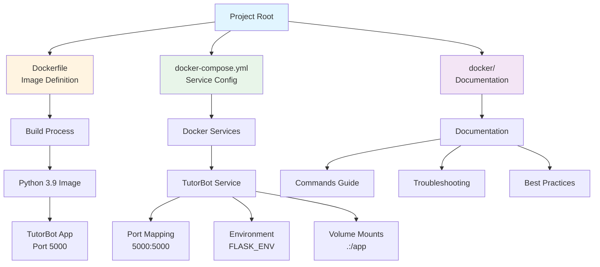
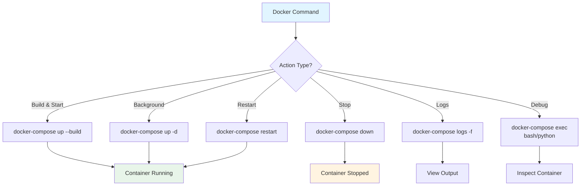
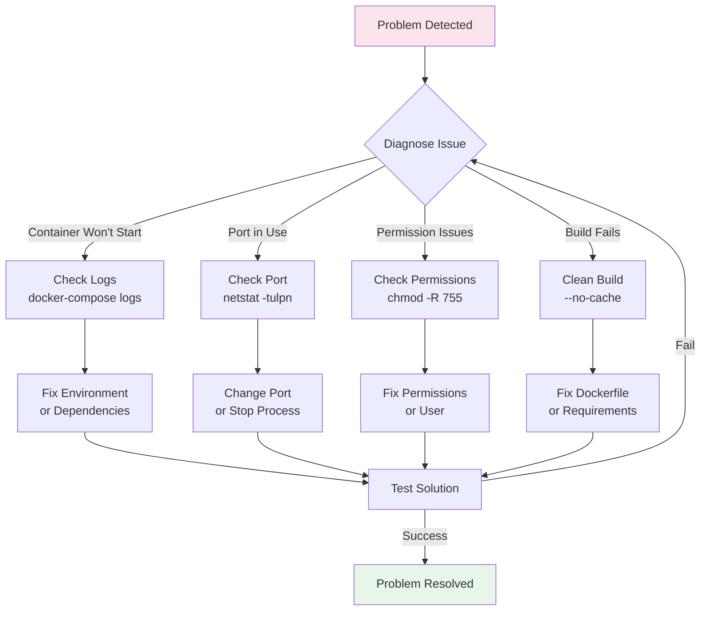

# TutorBot Docker Directory

This directory contains Docker-related documentation and additional configuration files.

## 📁 Docker Files Location

### Root Directory Files (Required)
The following Docker files must remain in the project root for proper functionality:

- **`../Dockerfile`** - Main Docker image definition
- **`../docker-compose.yml`** - Docker Compose configuration

### Why These Files Stay in Root?
- `docker-compose.yml` must be in the root for `docker-compose` commands to work
- `Dockerfile` is typically expected in the root or build context
- These are standard Docker conventions

## 🐳 Docker Configuration



### Main Dockerfile
Located at `../Dockerfile`:
```dockerfile
FROM python:3.9-slim
WORKDIR /app
COPY requirements.txt .
RUN pip install -r requirements.txt
COPY . .
EXPOSE 5000
CMD ["python", "main.py"]
```

### Docker Compose Configuration
Located at `../docker-compose.yml`:
```yaml
version: '3.8'
services:
  tutorbot:
    build: .
    ports:
      - "5000:5000"
    environment:
      - FLASK_ENV=production
    volumes:
      - .:/app
```

## 🚀 Docker Commands



### Basic Commands
```bash
# Build and start the application
docker-compose up --build

# Start in background
docker-compose up -d

# Stop the application
docker-compose down

# View logs
docker-compose logs -f tutorbot

# Restart the application
docker-compose restart tutorbot
```

### Development Commands
```bash
# Build without cache
docker-compose build --no-cache

# Run with specific environment
docker-compose -f docker-compose.yml -f docker-compose.dev.yml up

# Execute commands in container
docker-compose exec tutorbot python main.py
docker-compose exec tutorbot bash
```

### Debugging Commands
```bash
# View container status
docker-compose ps

# View resource usage
docker stats

# Inspect container
docker-compose exec tutorbot env
docker-compose exec tutorbot cat /app/main.py
```

## 🔧 Docker Configuration Management

### Environment Variables
The application uses environment variables from `.env` file:
```bash
# Export environment variables
source scripts/export_env.sh

# Or use Docker Compose env_file
docker-compose --env-file .env up
```

### Volume Mounts
The application mounts the current directory to `/app` in the container:
```yaml
volumes:
  - .:/app
```

This allows for:
- Live code changes without rebuilding
- Access to configuration files
- Persistent data storage

## 🎯 Docker Best Practices

### Security
- Use specific base image versions
- Run as non-root user when possible
- Minimize installed packages
- Use multi-stage builds for production

### Performance
- Use `.dockerignore` to exclude unnecessary files
- Optimize layer caching
- Use appropriate base images
- Minimize image size

### Development
- Use volume mounts for live development
- Separate development and production configs
- Use Docker Compose for multi-service setups
- Implement health checks

## 🔍 Troubleshooting



### Common Issues

#### Container Won't Start
```bash
# Check logs
docker-compose logs tutorbot

# Check container status
docker-compose ps

# Verify environment variables
docker-compose exec tutorbot env
```

#### Port Already in Use
```bash
# Check what's using the port
sudo netstat -tulpn | grep :5000

# Use different port
docker-compose up -p 5001:5000
```

#### Permission Issues
```bash
# Fix file permissions
chmod -R 755 .

# Run as specific user
docker-compose exec -u 1000:1000 tutorbot bash
```

#### Build Failures
```bash
# Clean build
docker-compose build --no-cache

# Check Dockerfile syntax
docker build -t test .

# Verify requirements.txt
docker-compose exec tutorbot pip list
```

## 📋 Docker Health Checks

### Application Health
The application should respond to health checks:
```bash
# Test application health
curl http://localhost:5000/health

# Check container health
docker-compose ps
```

### Database Connectivity
If using external databases:
```bash
# Test database connection
docker-compose exec tutorbot python -c "import requests; print('DB OK')"
```

## 🚀 Production Deployment

### Production Dockerfile
For production, consider using a multi-stage build:
```dockerfile
# Build stage
FROM python:3.9-slim as builder
WORKDIR /app
COPY requirements.txt .
RUN pip install --user -r requirements.txt

# Production stage
FROM python:3.9-slim
WORKDIR /app
COPY --from=builder /root/.local /root/.local
COPY . .
ENV PATH=/root/.local/bin:$PATH
EXPOSE 5000
CMD ["python", "main.py"]
```

### Production Docker Compose
```yaml
version: '3.8'
services:
  tutorbot:
    build: .
    ports:
      - "5000:5000"
    environment:
      - FLASK_ENV=production
    restart: unless-stopped
    healthcheck:
      test: ["CMD", "curl", "-f", "http://localhost:5000/health"]
      interval: 30s
      timeout: 10s
      retries: 3
```

## 📚 Related Documentation

- **Main Application**: `../main.py`
- **Requirements**: `../requirements.txt`
- **Environment**: `../.env`, `../env_example.txt`
- **Scripts**: `../scripts/`
- **Configuration**: `../config/`

## 🎉 Benefits of Docker Organization

### ✅ Clear Separation
- Docker files in root (as required)
- Documentation in docker/ folder
- Clear distinction between files and docs

### ✅ Easy Maintenance
- Centralized Docker documentation
- Clear troubleshooting guides
- Best practices documented

### ✅ Development Workflow
- Standardized Docker commands
- Consistent environment setup
- Easy debugging procedures 