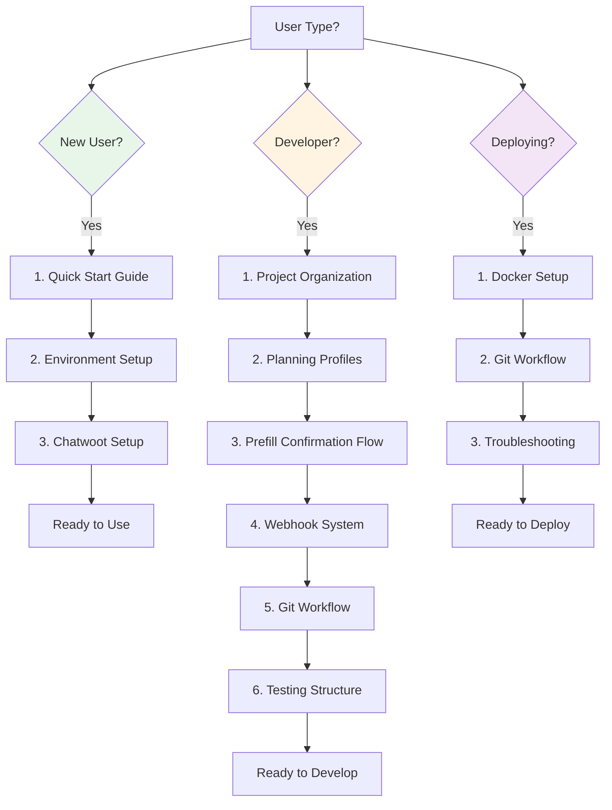

# 📚 TutorBot Documentation

Welcome to the TutorBot documentation! This comprehensive guide covers everything you need to know about setting up, developing, and deploying TutorBot.

## 🗂️ **Documentation Structure**

```mermaid
graph TB
    Docs[TutorBot Documentation] --> Getting[Getting Started]
    Docs --> Arch[Architecture & Setup]
    Docs --> Dev[Development]
    Docs --> Int[Integration]
    Docs --> API[API Reference]
    Docs --> Deploy[Deployment]
    Docs --> Ref[Reference]
    
    Getting --> G1[Quick Start Guide]
    Getting --> G2[Environment Setup]
    Getting --> G3[Docker Setup]
    Getting --> G4[Chatwoot Setup]
    
    Arch --> A1[Project Organization]
    Arch --> A2[Planning Profiles]
    Arch --> A3[Prefill Confirmation Flow]
    Arch --> A4[Webhook System]
    Arch --> A5[Age Verification]
    
    Dev --> D1[Git Workflow]
    Dev --> D2[Testing Structure]
    Dev --> D3[Workflow Documentation]
    
    Int --> I1[Integration Roadmap]
    Int --> I2[Stripe Payment]
    Int --> I3[WhatsApp Formatting]
    
    API --> API1[Mocked Functions]
    
    Deploy --> Dep1[Troubleshooting]
    
    Ref --> R1[Documentation Structure]
    Ref --> R2[Email Conventions]
    Ref --> R3[Calendar Email Conventions]
    
    style Docs fill:#e1f5ff
    style Getting fill:#e8f5e9
    style Arch fill:#fff4e1
    style Dev fill:#f3e5f5
    style Int fill:#fce4ec
```



### 🚀 **Getting Started**
- **[Quick Start Guide](SETUP/QUICK_START.md)** - Get up and running in minutes
- **[Environment Setup](SETUP/ENVIRONMENT.md)** - Configure your development environment
- **[Docker Setup](SETUP/DOCKER.md)** - Containerized deployment
- **[Chatwoot Setup](SETUP/CHATWOOT_SETUP.md)** - Configure Chatwoot integration

### 🏗️ **Architecture & Setup**
- **[Project Organization](ARCHITECTURE/PROJECT_ORGANIZATION.md)** - Code structure and conventions
- **[Planning Profiles](ARCHITECTURE/PLANNING_PROFILES.md)** - Customer segmentation and scheduling system
- **[Prefill Confirmation Flow](ARCHITECTURE/PREFILL_CONFIRMATION_FLOW.md)** - Critical user confirmation flow with WhatsApp menus
- **[Webhook System](ARCHITECTURE/WEBHOOK_SYSTEM.md)** - Webhook deduplication and error handling
- **[Age Verification](SETUP/AGE_VERIFICATION.md)** - Age verification system setup

### 🔧 **Development**
- **[Git Workflow](WORKFLOWS/GIT_WORKFLOW.md)** - Safe development and deployment workflow
- **[Testing Structure](DEVELOPMENT/TESTING_STRUCTURE.md)** - Testing framework and guidelines
- **[Workflow Documentation](WORKFLOWS/WORKFLOW_DOCUMENTATION.md)** - Development workflows

### 🔌 **Integration**
- **[Integration Roadmap](INTEGRATION/INTEGRATION_ROADMAP.md)** - Current and planned integrations
- **[Stripe Payment Integration](INTEGRATION/STRIPE_PAYMENT_INTEGRATION.md)** - Complete Stripe payment system
- **[WhatsApp Formatting](INTEGRATION/WHATSAPP_FORMATTING.md)** - WhatsApp message formatting guide

### 📡 **API Reference**
- **[Mocked Functions](API/CURRENT_MOCKED_FUNCTIONS.md)** - Current API mock implementations

### 🚀 **Deployment**
- **[Troubleshooting](DEPLOYMENT/TROUBLESHOOTING.md)** - Common issues and solutions

### 📖 **Reference**
- **[Documentation Structure](REFERENCE/DOCUMENTATION_STRUCTURE.md)** - How this documentation is organized
- **[Email Conventions](REFERENCE/EMAIL_CONVENTIES.md)** - Email formatting standards
- **[Calendar Email Conventions](REFERENCE/KALENDER_EMAIL_CONVENTIES.md)** - Calendar email standards

## 🎯 **Quick Navigation**



### **For New Users:**
1. Start with [Quick Start Guide](SETUP/QUICK_START.md)
2. Set up your [Environment](SETUP/ENVIRONMENT.md)
3. Configure [Chatwoot](SETUP/CHATWOOT_SETUP.md)

### **For Developers:**
1. Read [Project Organization](ARCHITECTURE/PROJECT_ORGANIZATION.md)
2. Understand [Planning Profiles](ARCHITECTURE/PLANNING_PROFILES.md)
3. Review [Prefill Confirmation Flow](ARCHITECTURE/PREFILL_CONFIRMATION_FLOW.md) - Critical for WhatsApp menus
4. Study [Webhook System](ARCHITECTURE/WEBHOOK_SYSTEM.md) - Error handling and deduplication
5. Follow the [Git Workflow](WORKFLOWS/GIT_WORKFLOW.md)
6. Check [Testing Structure](DEVELOPMENT/TESTING_STRUCTURE.md)

### **For Deployment:**
1. Use [Docker Setup](SETUP/DOCKER.md)
2. Follow [Git Workflow](WORKFLOWS/GIT_WORKFLOW.md)
3. Check [Troubleshooting](DEPLOYMENT/TROUBLESHOOTING.md) if issues arise

## 🛠️ **Development Workflow**

```mermaid
gitgraph
    commit id: "Initial"
    branch develop
    checkout develop
    commit id: "Setup"
    branch feature/my-feature
    checkout feature/my-feature
    commit id: "Add feature"
    commit id: "Fix bugs"
    checkout develop
    merge feature/my-feature
    commit id: "Test on develop"
    branch main
    checkout main
    merge develop
    commit id: "Deploy to production"
```

### **Safe Development Process:**
```bash
# 1. Create feature branch
gitfeature my-feature

# 2. Make changes and commit
git add .
git commit -m "Add new feature"

# 3. Test on develop
gitmerge

# 4. Deploy to production
gitdeploy
```

### **Quick Commands:**
- `gitstatus` - Check current status
- `gitfeature <name>` - Create feature branch
- `gitmerge` - Merge to develop
- `gitdeploy` - Safe deploy to production

## 🔗 **External Resources**

- **GitHub Repository**: [stephenadei/tutorbot](https://github.com/stephenadei/tutorbot)
- **Chatwoot Documentation**: [Chatwoot Docs](https://www.chatwoot.com/docs)
- **WhatsApp Business API**: [WhatsApp Business API](https://developers.facebook.com/docs/whatsapp)

## 📝 **Contributing**

When contributing to the documentation:

1. Follow the existing structure
2. Use clear, descriptive headings
3. Include code examples where helpful
4. Update this README if adding new sections
5. Test all commands and examples

## 🆘 **Need Help?**

- Check the [Troubleshooting Guide](DEPLOYMENT/TROUBLESHOOTING.md)
- Review [Common Issues](DEPLOYMENT/TROUBLESHOOTING.md#common-issues)
- Check [GitHub Issues](https://github.com/stephenadei/tutorbot/issues)

---

**💡 Tip**: Use the search function in your browser (Ctrl+F) to quickly find specific topics within each document. 