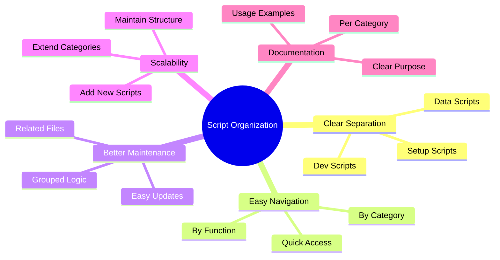

# Scripts Directory - Organized Structure

This directory contains all utility scripts organized by functionality.

## 📁 Directory Structure

```mermaid
graph TD
    A[scripts/] --> B[cw_api.py<br/>Core API]
    A --> C[help.sh<br/>Help Script]
    A --> D[dev/]
    A --> E[data/]
    A --> F[debug/]
    A --> G[setup/]
    A --> H[analysis/]
    A --> I[testing/]
    
    D --> D1[dev.sh<br/>Shortcuts]
    D --> D2[export_env.sh<br/>Environment]
    
    E --> E1[wipe.sh<br/>Quick Wipe]
    E --> E2[wipe_all.sh<br/>Full Wipe]
    E --> E3[wipe_contacts.py<br/>Manual Wipe]
    E --> E4[cleanup_all.py<br/>Cleanup]
    
    F --> F1[debug_*.sh<br/>Debug Mode]
    F --> F2[confirm_*.sh<br/>Confirmation]
    
    G --> G1[setup_all.py<br/>Complete Setup]
    G --> G2[setup_attributes.py<br/>Attributes]
    G --> G3[setup_labels.py<br/>Labels]
    G --> G4[setup_chatwoot.py<br/>Chatwoot]
    
    H --> H1[analyze_logs.py<br/>Log Analysis]
    H --> H2[validate_structure.py<br/>Validation]
    H --> H3[audit_attributes.py<br/>Audit]
    
    I --> I1[test_bot.py<br/>Bot Testing]
    I --> I2[test_chatwoot_api.py<br/>API Testing]
    I --> I3[show_prefill_overview.py<br/>Prefill Test]
    
    style A fill:#e1f5ff
    style D fill:#e8f5e9
    style E fill:#fff4e1
    style G fill:#f3e5f5
    style H fill:#fce4ec
    style I fill:#e1f5ff
```



```
scripts/
├── cw_api.py              # Chatwoot API utilities (core)
├── help.sh                # This help script
├── dev/                   # Development scripts
│   ├── dev.sh             # Development shortcuts
│   └── export_env.sh      # Environment export script
├── data/                  # Data management scripts
│   ├── wipe.sh            # Quick contact wipe script
│   ├── wipe_all.sh        # Quick data wipe script
│   ├── wipe_contacts.py   # Manual contact wipe
│   ├── wipe_all.py        # Manual data wipe
│   └── cleanup_all.py     # Clean up all data
├── debug/                 # Debug and confirmation scripts
│   ├── debug_*.sh         # Debug management scripts
│   └── confirm_*.sh       # Confirmation management scripts
├── setup/                 # Setup and configuration scripts
│   ├── setup_attributes.py    # Setup custom attributes
│   ├── setup_labels.py        # Setup labels
│   ├── setup_all.py           # Setup everything
│   ├── setup_automation_rules.py
│   ├── setup_chatwoot.py      # Setup Chatwoot configuration
│   └── setup_custom_attributes.py
├── analysis/              # Analysis and audit scripts
│   ├── analyze_logs.py        # Analyze log files
│   ├── check_inboxes.py       # Check inbox status
│   ├── list_contact_languages.py
│   ├── list_automation.py     # List automation rules
│   ├── audit_attributes.py    # Audit custom attributes
│   └── validate_structure.py  # Validate project structure
└── testing/               # Testing scripts
    ├── show_prefill_overview.py # Show prefill overview
    ├── test_bot.py            # Test bot functionality
    ├── test_chatwoot_api.py   # Test Chatwoot API
    ├── test_input_select.py   # Test input selection
    ├── test_real_message.py   # Test with real message
    └── test_real_conversation.py
```

## 🔧 Script Categories

### **Development (`dev/`)**
- **`dev.sh`** - Development shortcuts (restart, rebuild, logs, clean)
- **`export_env.sh`** - Export environment variables from `.env`

### **Data Management (`data/`)**
- **`wipe.sh`** - Quick contact wipe (automatic)
- **`wipe_all.sh`** - Quick data wipe (labels + attributes)
- **`wipe_contacts.py`** - Manual contact wipe with options
- **`wipe_all.py`** - Manual data wipe with options
- **`cleanup_all.py`** - Comprehensive cleanup

### **Debug & Confirmation (`debug/`)**
- **`debug_*.sh`** - Debug mode management
- **`confirm_*.sh`** - Confirmation mode management

### **Setup & Configuration (`setup/`)**
- **`setup_*.py`** - Chatwoot configuration scripts
- **`setup_all.py`** - Complete setup (attributes + labels)

### **Analysis & Audit (`analysis/`)**
- **`analyze_logs.py`** - Log file analysis
- **`check_inboxes.py`** - Inbox status checking
- **`list_*.py`** - Data listing utilities
- **`audit_attributes.py`** - Attribute auditing
- **`validate_structure.py`** - Project structure validation

### **Testing (`testing/`)**
- **`test_*.py`** - Individual component testing
- **`show_prefill_overview.py`** - Prefill functionality testing

## 🚀 Quick Commands

```bash
# Development
./scripts/dev/dev.sh restart              # Quick restart
./scripts/dev/dev.sh rebuild              # Rebuild and restart
./scripts/dev/export_env.sh               # Export environment

# Data Management
./scripts/data/wipe.sh                    # Quick contact wipe
./scripts/data/wipe_all.sh                # Quick data wipe
python3 scripts/data/wipe_contacts.py     # Manual contact wipe

# Setup
python3 scripts/setup/setup_all.py        # Setup everything
python3 scripts/setup/setup_attributes.py # Setup attributes only

# Analysis
python3 scripts/analysis/validate_structure.py  # Validate structure
python3 scripts/analysis/analyze_logs.py        # Analyze logs

# Testing
python3 scripts/testing/test_bot.py             # Test bot functionality
python3 scripts/testing/show_prefill_overview.py # Test prefill
```

## 📋 Aliases (Updated)

All aliases in `~/.bashrc` have been updated to point to the new locations:

- `wipe` → `./scripts/data/wipe.sh`
- `wipeall` → `./scripts/data/wipe_all.sh`
- `validate` → `python3 scripts/analysis/validate_structure.py`
- `help` → `./scripts/help.sh`
- `debug*` → `./scripts/debug/debug_*.sh`
- `confirm*` → `./scripts/debug/confirm_*.sh`

## 🎯 Benefits of Organization



1. **Clear Separation** - Each category has its own folder
2. **Easy Navigation** - Find scripts by functionality
3. **Better Maintenance** - Related scripts are grouped together
4. **Scalability** - Easy to add new scripts to appropriate folders
5. **Documentation** - Each folder can have its own README

## 📚 Related Documentation

- `docs/INTEGRATION_ROADMAP.md` - Calendar & payment integration plan
- `docs/CURRENT_MOCKED_FUNCTIONS.md` - Mocked functions overview
- `docs/WHATSAPP_FORMATTING.md` - WhatsApp formatting guide

---

*Last Updated: August 7, 2025*
*Status: Fully Organized* 